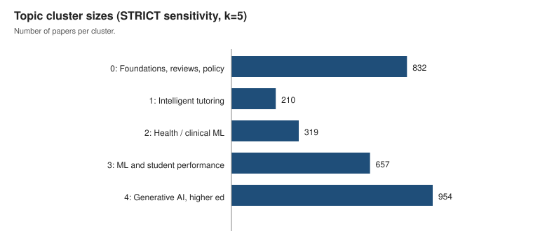
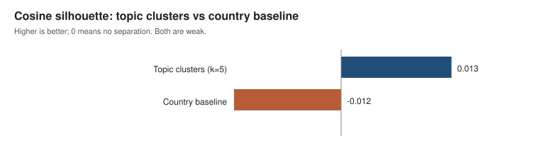
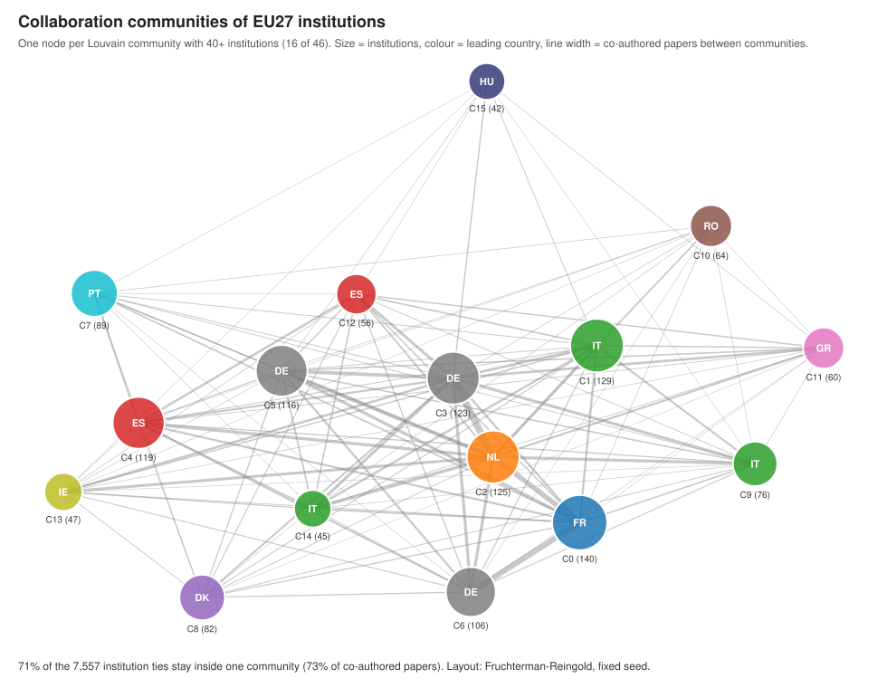
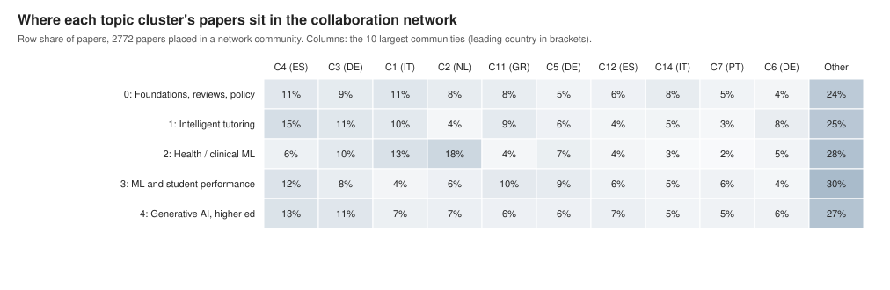

# Who drives AI-in-education research in Europe?

**Project D · Data Analytics (MDE-CO-02) · Fall 2026 · Constructor University**

Team: Shifa Kayumbhai Bhari (data), Dev Charan (descriptive analysis),
Mabango Nyikuri (search validation), Panchumarthi Keerthana (collaboration
networks), Magaseng John Manchidi (clustering and interpretation).

> Draft assembled from the team's documents. Mabango proofreads (guide,
> Step 9.1). Section sources are named so each owner can check their numbers.

## 1. Question and answer

**Which European institutions and venues drive research on AI in education
since 2020, and do they form one collaboration community or several?**

No single institution or venue drives the field. The most productive
institution, the University of Eastern Finland, appears on 96 of 7,594
candidate papers (1.3%), and the top ten venues hold 20% of the
Scopus-listed records. The institutions form **several collaboration
communities, mostly national or regional**. Research topics cut across those
communities, so knowing a paper's topic says almost nothing about who wrote
it. Our search finds only about a fifth of the relevant papers, so rankings
are provisional.

## 2. Data and methods

*Source: `project-d/README_data_preparation.md` (Shifa).*

- **Collection.** Five OpenAlex queries ("artificial intelligence in
  education", "AI in education", "intelligent tutoring system", "machine
  learning" and education, "generative AI" and education) returned 75,126
  records, 67,684 unique after deduplication by OpenAlex ID.
- **Candidates (ALL).** Papers from 2020 on with at least one EU-affiliated
  author: 7,594.
- **Relevance screen.** A keyword check on titles and abstracts flags 6,442
  as "Likely relevant" and 1,152 as "Needs checking". It is not a manual
  validation.
- **STRICT.** Papers whose venue matches the Scopus source list by ISSN with
  coverage in the publication year: 3,668. The definition is provisional.

### Clustering method (John)

*Source: `docs/CLUSTERING_AND_INTERPRETATION.md`.*

TF-IDF (English stop words, unigrams and bigrams, `min_df=3`, `max_df=0.90`,
12,000 features, sublinear term frequency) and KMeans (`random_state=42`,
`n_init=10`), with k from 4 to 10. Text clustering suits the question because
the aim is to find thematic groups in titles and abstracts without labels,
and KMeans on TF-IDF is simple, repeatable and easy to explain. We evaluate
with cosine silhouette (sample of up to 2,000 records) and compare against a
baseline that groups papers by dominant country.

### Network method

*Source: `src/collaboration_analysis.py`.* Institutions are nodes and
co-authored papers are weighted edges, using EU27 affiliations with explicit
or uniquely inferred country metadata. Louvain community detection runs on
the non-isolated network. Topic clusters are linked to communities by
placing each paper in the plurality community of its institutions
(`src/cluster_network_crosswalk.py`).

## 3. Results

### 3.1 Institutions, countries and venues (RQ1, Dev)

| Rank | Institution (ALL candidates) | Papers |
|---:|---|---:|
| 1 | University of Eastern Finland | 96 |
| 2 | Centre National de la Recherche Scientifique | 93 |
| 3 | University of Bonn | 86 |
| 4 | Leibniz University Hannover | 80 |
| 5 | Technical University of Munich | 78 |

Of 2,489 institutions the median has 2 papers and only 361 have 10 or more.
Germany (1,382 papers), Spain (1,137) and Italy (908) lead by country (full
counting, so a paper with authors in several countries counts for each).
Venue results cover STRICT only. The 3,668 records spread over 1,402 venues.
The top two are Springer book series, followed by *Education Sciences* (84),
*Frontiers in Education* (75) and *Applied Sciences* (68).

### 3.2 Growth and ALL vs STRICT (RQ2, Dev)

| Year | ALL | STRICT | STRICT share |
|---:|---:|---:|---:|
| 2020 | 329 | 139 | 42.2% |
| 2021 | 369 | 207 | 56.1% |
| 2022 | 420 | 236 | 56.2% |
| 2023 | 725 | 365 | 50.3% |
| 2024 | 1,308 | 633 | 48.4% |
| 2025 | 2,062 | 992 | 48.1% |
| 2026 (partial) | 2,381 | 1,096 | 46.0% |

ALL output grew more than sixfold from 2020 to 2025, with the steepest rises
in 2023 and 2024. STRICT keeps 48% of records and follows the same trend, so
the filter mainly changes volume. Its share falls from 56% to 46%, which may
mean newer venues are not yet on the Scopus list (not tested). STRICT is not
a relevance filter: *Alzheimer's & Dementia* (43 records) sits in the
provisional STRICT set.

### 3.3 Topic clusters (RQ3, John)

We first clustered the 3,095 STRICT likely-relevant records (best tested k=8,
silhouette 0.012). A targeted manual review of 125 records from two
health-heavy clusters found 123 out of scope and 2 relevant. After removing
the 123, the best tested k is 5 on 2,972 records (silhouette 0.013, ARI 0.53
against the original assignment).

| Cluster | Records | Share | Interpretation |
|---:|---:|---:|---|
| 0 | 832 | 28.0% | Broad foundations, reviews and policy |
| 1 | 210 | 7.1% | Intelligent tutoring and adaptive learning |
| 2 | 319 | 10.7% | Health and clinical machine-learning crossover |
| 3 | 657 | 22.1% | Machine learning and student performance |
| 4 | 954 | 32.1% | Generative AI, higher education, teachers and students |

**Method evaluation.** Topic clusters score a cosine silhouette of 0.013
against -0.012 for the country baseline. Topic grouping is slightly better
than country grouping, but both values are near zero. The clusters overlap
heavily and are best read as broad themes, not sharply separated topics.
Silhouette changes little with k (0.0087 to 0.0126 for k=4 to 10), so k=5 is
a convenient choice, not a clearly better one. We
report this rather than tuning k to make the score look better.

### 3.4 Collaboration communities (RQ3, network analysis)

The network has 1,641 institutions, 7,557 ties and 168 connected components.
139 institutions have no EU27 collaborator. Louvain finds 46 communities
(modularity 0.64), of which 16 hold more than 90 papers each. 71% of ties
stay inside a community.

The large communities follow countries: community 0 is 118 of 140
institutions French, community 1 is 89 of 129 Italian, community 4 is 68 of
119 Spanish, community 7 is 56 of 89 Portuguese and community 11 is 36 of 60
Greek. Several others mix countries (2, 6, 9, 12).

### 3.5 Do topics follow collaboration? (RQ3, John)

| Comparison | NMI | NMI if labels shuffled | ARI |
|---|---:|---:|---:|
| Topic cluster vs network community | 0.027 | 0.014 | 0.004 |
| Topic cluster vs dominant country | 0.028 | 0.009 | 0.001 |
| Network community vs dominant country | 0.452 | 0.043 | 0.273 |

Topic clusters and network communities overlap only slightly more than
chance, while communities and countries overlap far above chance. Each
community contains all five topic groups.

### 3.6 What the search misses (RQ4, Mabango)

*Source: `02_search_validation.ipynb`.*

| Measure | Value |
|---|---|
| Precision, 100-paper audit (Unclear left out) | 79.8% (95% CI 70.6-86.7%) |
| Recall against 200 OpenAlex AI-in-education EU papers | 21.0% (95% CI 15.9-27.2%) |
| Recall, English / non-English | 28.2% / 10.8% |
| Works with no country | 26.5-37.4% across the five searches |

Common false positives are AI papers with no education link and health or
patient education. Missed papers often use terms such as ChatGPT, chatbot,
LLM or GenAI without the query phrases, and many are not in English.

## 4. Interpretation

1. **The field is spread out.** No institution holds more than 1.3% of
   candidate papers and no venue dominates. The early ranking (2020-2022)
   was thin and has since been reshuffled by rapid growth, while the
   University of Eastern Finland stays near the top.
2. **Collaboration is local.** Most ties are inside a community, and the
   large communities are mostly national or regional. Cross-border
   collaboration exists, but it is the exception.
3. **Topic and collaboration are separate dimensions.** The same themes,
   such as generative AI in higher education, are studied in many countries
   by groups that rarely co-author. A "who works on what" story based on
   country would not be supported by the data.
4. **Scopus membership is a venue filter, not a relevance filter.** Manual
   review removed 123 of 125 checked records from the STRICT set.

See `docs/INTERPRETATION.md` for the research-question-by-question answers.

## 5. Limitations and what would change the conclusion

- **Recall of about 21%.** If the missing papers are mostly non-English, the
  rankings and the national communities could shift. The "several
  communities" result probably holds, but we cannot show it.
- **Precision of about 80%.** Some institutions and clusters reflect
  off-topic papers. The manual review covered only two clusters, so other
  false positives remain and its exclusion share is not an error rate.
- **EU27 scope.** The network ignores collaboration with the UK,
  Switzerland, Norway and non-European partners. Including them could merge
  communities.
- **Louvain splits sparse graphs.** The count of 46 communities depends on
  the algorithm and graph definition. A sensitivity run with other settings
  would test it.
- **Weak text clusters.** Silhouette near 0.01 means the themes overlap.
  OpenAlex concepts or sentence embeddings might separate topics better.
- **Missing affiliations.** 26.5-37.4% of works lost their country, so country-based results rest on incomplete data. The network
  analysis matched 2,908 of 2,972 papers to local records.
- **2026 is a partial year, and STRICT is provisional.**
- **Scope of "AI in education".** If AI-assisted patient education counts,
  part of the excluded health cluster returns.

## 6. Reproducibility

See the README for the run order. The pipeline needs the OpenAlex pull,
which is not committed, and the Python packages in `requirements.txt`.

## 7. AI use

See `docs/ai_use_log.md`.
